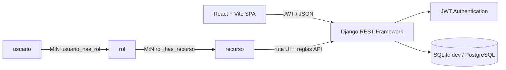

# EcoRutas

Plataforma de turismo de naturaleza con arquitectura desacoplada: **Django REST Framework** expone la API y **React + Vite** ofrece la SPA. El backend valida autenticación y permisos; el frontend consume los contratos REST con Axios y JWT.

## Arquitectura



El menú de `GET /api/usuarios/menu/` se construye con los recursos enlazados a los roles relacionales del usuario. `HasResourcePermission` comprueba las reglas por ruta y método en cada endpoint protegido; las protecciones de rutas React son solo una ayuda de navegación y no sustituyen la autorización del servidor.

Las tablas `usuario`, `rol` y `recurso` usan claves primarias. `usuario_has_rol` y `rol_has_recurso` tienen claves foráneas indexadas por Django y restricciones únicas compuestas para impedir asignaciones duplicadas.

## Requisitos

- Python 3.12 o superior y `pip`.
- Node.js 18 o superior y `npm`.
- SQLite para desarrollo local (incluido con Python); PostgreSQL es opcional.

## Ejecutar en desarrollo

Clona el repositorio y entra a su raíz:

```bash
git clone https://github.com/saithfortxd1/ecorutas-avz.git
cd ecorutas-avz
```

### Backend

```bash
python -m venv venv
# Windows PowerShell: .\venv\Scripts\Activate.ps1
# macOS/Linux: source venv/bin/activate
pip install -r requirements.txt
```

Crea la configuración local desde el ejemplo y configura una `SECRET_KEY` propia:

```bash
cp .env.example .env
```

En Windows PowerShell se puede copiar con `Copy-Item .env.example .env`. Conserva `DEBUG=True` solo en desarrollo. Después:

```bash
python manage.py migrate
python manage.py runserver
```

La API queda en `http://127.0.0.1:8000/`. `CORS_ALLOWED_ORIGINS` y `ALLOWED_HOSTS` se configuran desde `.env`; el ejemplo permite Vite en `http://localhost:5173` y `http://127.0.0.1:5173`.

### Frontend

En otra terminal, desde el directorio `frontend/`:

```bash
npm ci
cp .env.example .env
npm run dev
```

En Windows PowerShell, usa `Copy-Item .env.example .env`. La SPA abre en `http://localhost:5173`; `VITE_API_BASE_URL` por defecto apunta a `http://127.0.0.1:8000/api`.

Comprobación del build de producción:

```bash
npm run build
npm run preview
```

### Base de datos de demostración

Para poblar roles, recursos y datos de ejemplo en desarrollo:

```bash
python manage.py seed_db
```

`seed_db --clean` borra los datos de catálogo y usuarios no superusuarios antes de crear datos nuevos. Está deshabilitado cuando `DEBUG=False`, salvo que se fuerce explícitamente; no ejecutes opciones destructivas en una base de producción.

Para crear la cuenta administrativa local de demostración, aplica primero las migraciones y luego crea el superusuario. Ejemplo en PowerShell:

```powershell
$env:DJANGO_SUPERUSER_PASSWORD = 'admin1234'
python manage.py createsuperuser --noinput --username admin --email admin@ecorutas.com
Remove-Item Env:DJANGO_SUPERUSER_PASSWORD
python manage.py seed_db
```

En macOS/Linux puedes establecer `DJANGO_SUPERUSER_PASSWORD=admin1234` antes de `createsuperuser`. El seeder asigna el rol relacional Administrador a superusuarios y prepara los recursos base.

**Credencial de demostración local:** `admin` / `admin1234`. Es una contraseña pública de desarrollo: cámbiala inmediatamente y no la uses ni la despliegues en producción.

## API principal

Todas las rutas siguientes cuelgan de `/api/`.

| Método y ruta | Uso |
|---|---|
| `POST /login/` | Obtener access y refresh JWT |
| `POST /login/refresh/` | Renovar el access token |
| `POST /usuarios/registro/` | Registrar turista o anfitrión |
| `GET /usuarios/me/` | Consultar el perfil autenticado |
| `GET /usuarios/menu/` | Consultar el menú autorizado según roles y recursos |
| `GET, POST /usuarios/admin/` | Listar o crear usuarios (administración) |
| `GET, PUT, PATCH, DELETE /usuarios/admin/{id}/` | Consultar o modificar un usuario |
| `GET, POST /usuarios/roles/` | Listar o crear roles |
| `GET, PUT, PATCH, DELETE /usuarios/roles/{id}/` | Consultar o modificar un rol y sus recursos |
| `GET, POST /usuarios/recursos/` | Listar o crear recursos |
| `GET, PUT, PATCH, DELETE /usuarios/recursos/{id}/` | Consultar o modificar un recurso y sus permisos |
| `GET, POST /catalogo/categorias/` | Consultar categorías; escritura solo con rol/permiso autorizado |
| `GET, POST /catalogo/experiencias/` | Consultar o crear experiencias; soporta `?search=` y `?ordering=` |
| `GET, POST /catalogo/disponibilidades/` | Consultar o gestionar disponibilidad autorizada |

Los endpoints administrativos requieren sesión JWT y permisos de recurso asignados. La API documentada también está disponible en `/docs/` (Swagger) y `/redoc/`.

## Tecnologías y carpetas

- `usuarios/`: usuario Django y modelo RBAC M:N, serializadores, permisos y endpoints administrativos.
- `catalogo/`: categorías, experiencias, imágenes y disponibilidades.
- `core/`: settings, rutas, CORS, autenticación JWT y documentación API.
- `frontend/`: SPA React/Vite, rutas lazy, estado de sesión, servicios Axios y vistas.

## Rendimiento

Los perfiles y listas administrativas precargan sus relaciones M:N; el menú se resuelve con una consulta de recursos y se cachea en el backend. El cliente restaura un snapshot de sesión asociado al ID del JWT y revalida perfil y menú en paralelo; las listas administrativas usan un TTL de 15 segundos y se invalidan después de sus mutaciones. La precarga de pantalla ocurre al enfocar o pasar el puntero por los enlaces disponibles.

Estos mecanismos reducen trabajo repetido, pero no garantizan latencias universales inferiores a 10 ms: red, base de datos, dispositivo y carga determinan los tiempos medidos.

## Configuración sensible

No incluyas `.env`, credenciales, `venv/`, `node_modules/` ni `dist/` en Git. El repositorio ignora estos archivos y directorios; usa `.env.example` solo como plantilla sin secretos.
