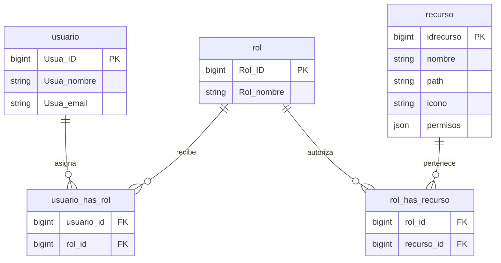

# EcoRutas

Plataforma de turismo de naturaleza con una API en **Django REST Framework** y una aplicación SPA en **React + Vite**. La API administra cuentas, catálogo y permisos; React consume sus endpoints con Axios y autenticación JWT.

## Estructura del proyecto

En el espacio de trabajo local, los proyectos aparecen como dos carpetas hermanas:

```text
workspace/
├── ecorutas-backend/             # Checkout local y raíz Git: Django y el frontend rastreado
│   ├── catalogo/                 # Experiencias, categorías, fotos y disponibilidades
│   ├── core/                     # Configuración Django, CORS y rutas globales
│   ├── usuarios/                 # Usuarios, autenticación y RBAC relacional
│   ├── frontend/                 # React + Vite dentro de este repositorio
│   ├── manage.py
│   ├── requirements.txt
│   └── README.md
└── ecorutas-frontend/            # Copia hermana de React + Vite de este espacio de trabajo
    ├── src/
    ├── package.json
    └── vite.config.js
```

El repositorio GitHub `ecorutas-avz` contiene el backend en su raíz y el frontend rastreado en `frontend/`. La carpeta hermana `ecorutas-frontend/` es una copia local de trabajo y no es un submódulo ni una carpeta versionada por este repositorio. Para clonar y trabajar únicamente con GitHub, usa `frontend/`.

## Tecnologías

- Python 3.12+ y Django REST Framework.
- SimpleJWT para autenticación y renovación de tokens.
- React 18, Vite, React Router y Axios.
- SQLite para desarrollo local; PostgreSQL puede configurarse para otros entornos.

## Modelo RBAC relacional

Los roles y recursos se vinculan mediante relaciones muchos-a-muchos. Las tablas intermedias mantienen las asignaciones normalizadas:



`usuario_has_rol` conecta usuarios con roles y `rol_has_recurso` conecta roles con recursos. Las restricciones únicas evitan duplicar una misma pareja de asignación. Cada recurso describe su ruta de interfaz y las rutas/métodos de API autorizados.

### Menú dinámico y autorización

`GET /api/usuarios/menu/` requiere un JWT válido. Devuelve los recursos asociados a los roles del usuario, por ejemplo:

```json
{
  "version": 1730000000.0,
  "items": [
    { "id": 1, "nombre": "Catálogo", "path": "/experiencias", "icono": "map" }
  ]
}
```

La SPA usa `items` para mostrar enlaces y proteger rutas directas. En el backend, `HasResourcePermission` comprueba también la ruta y el método del endpoint contra los permisos del recurso; ocultar una opción en React no sustituye la autorización del servidor.

## Requisitos e instalación

- Python 3.12 o superior y `pip`.
- Node.js 18 o superior y `npm`.
- Git.

Clona el repositorio y entra a su raíz:

```bash
git clone https://github.com/saithfortxd1/ecorutas-avz.git
cd ecorutas-avz
```

### Configurar y ejecutar el backend

Desde la raíz del repositorio (la carpeta que contiene `manage.py`):

```bash
python -m venv venv
# Windows PowerShell: .\venv\Scripts\Activate.ps1
# macOS/Linux: source venv/bin/activate
pip install -r requirements.txt
```

Copia `.env.example` como `.env` y configura una clave secreta para tu entorno. En PowerShell:

```powershell
Copy-Item .env.example .env
```

En macOS/Linux:

```bash
cp .env.example .env
```

Aplica las migraciones y levanta Django:

```bash
python manage.py migrate
python manage.py runserver
```

La API local queda en `http://127.0.0.1:8000/api/`. Swagger está disponible en `http://127.0.0.1:8000/docs/`. Configura `ALLOWED_HOSTS` y `CORS_ALLOWED_ORIGINS` en `.env` para los dominios de tu entorno; Vite suele ejecutarse en `http://localhost:5173`.

Con `DEBUG=True`, el proyecto usa MD5 de Django para agilizar el desarrollo y conserva PBKDF2 como verificador de hashes existentes. Con `DEBUG=False` no activa ese hasher rápido y se mantienen los hashers seguros predeterminados de Django.

### Ejecutar React + Vite

En otra terminal, desde la carpeta `frontend/` dentro de la raíz del repositorio:

```bash
npm ci
# Copia .env.example como .env si necesitas cambiar VITE_API_BASE_URL
npm run dev
```

Abre `http://localhost:5173/`. La URL de API por defecto es `http://127.0.0.1:8000/api`.

En el espacio de trabajo local también existe la carpeta hermana `ecorutas-frontend/`; si trabajas directamente desde esa copia, ejecuta los mismos comandos dentro de ella. Mantén sus archivos sincronizados con `frontend/` si quieres incluir los cambios en este repositorio.

Para compilar y previsualizar una versión de producción:

```bash
npm run build
npm run preview
```

### Crear un administrador local

Después de migrar, crea una cuenta administrativa con una contraseña propia:

```bash
python manage.py createsuperuser
```

El seeder asigna a los superusuarios el rol relacional Administrador y sus recursos base. No reutilices contraseñas de demostración en producción.

## Cargar experiencias colombianas con precios COP

Desde la raíz de Django, ejecuta:

```bash
python manage.py seed_db --reemplazar-experiencias
```

El comando carga 100 variantes de demostración permutando actividades en destinos colombianos de La Guajira, la Sierra Nevada, Tayrona, el Eje Cafetero, el Pacífico, la Amazonía y otras regiones. Los precios se guardan como valores decimales enteros en COP y las interfaces los presentan con formato colombiano. Estos registros de seeding no certifican por sí solos disponibilidad ni ofertas de operadores turísticos.

`--reemplazar-experiencias` elimina las experiencias existentes y sus fotos, traducciones y disponibilidades relacionadas antes de insertar las 100 variantes. No elimina usuarios, roles ni categorías; puede crear categorías base que aún no existan. Por defecto no genera lotes de usuarios de prueba ni disponibilidades. Si no hay ningún usuario con rol Anfitrión, crea la cuenta local de respaldo `anfitrion_test` con contraseña `testpass123`, que debe cambiarse o eliminarse de inmediato. El comando está protegido cuando `DEBUG=False`; no lo ejecutes contra datos de producción. La opción `--clean` tiene un alcance más amplio y además elimina categorías y usuarios que no sean superusuarios.

## Endpoints principales

Todas las rutas de la tabla están bajo `/api`:

| Método y ruta | Función |
|---|---|
| `POST /login/` | Obtener tokens JWT de acceso y renovación |
| `POST /login/refresh/` | Renovar el token de acceso |
| `POST /usuarios/registro/` | Registrar turista o anfitrión |
| `GET /usuarios/me/` | Consultar el perfil autenticado |
| `GET /usuarios/menu/` | Obtener los recursos del menú autorizados por RBAC |
| `GET, POST /usuarios/admin/` | Listar y crear usuarios (administración) |
| `/usuarios/admin/{id}/` | Consultar, actualizar o eliminar un usuario |
| `GET, POST /usuarios/roles/` | Listar y crear roles |
| `/usuarios/roles/{id}/` | Consultar, actualizar o eliminar roles y sus recursos |
| `GET, POST /usuarios/recursos/` | Listar y crear recursos |
| `/usuarios/recursos/{id}/` | Consultar, actualizar o eliminar recursos y permisos |
| `/catalogo/categorias/` | Consultar y administrar categorías según permisos |
| `/catalogo/experiencias/` | Consultar y administrar experiencias; admite `?search=` y `?ordering=` |
| `/catalogo/disponibilidades/` | Consultar y administrar disponibilidades según permisos |

Los endpoints administrativos requieren JWT y el permiso asociado al recurso. Las operaciones de escritura también aplican sus reglas de rol y propiedad.

## Comprobaciones locales

```bash
python manage.py check
python manage.py test
```

Desde `frontend/`:

```bash
npm run build
```

## Configuración sensible

No subas `.env`, `db.sqlite3`, entornos virtuales, `node_modules/` ni `dist/`. Git los ignora; utiliza `.env.example` solo como plantilla sin secretos.
